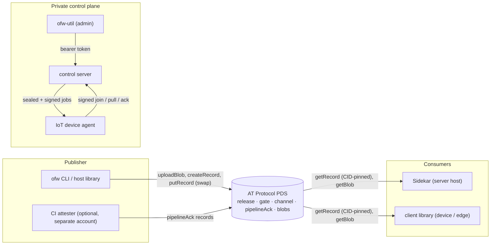

# Open Firmware

Open Firmware distributes firmware images, packages and container images to devices and edge servers as **content-addressed, optionally OEM-signed releases stored on an AT Protocol Personal Data Server (PDS)**. A publisher writes an immutable release record whose payload is split into blobs, plus a small mutable channel pointer. A device or host agent follows the pointer, pins the exact record version, checks every byte against the digests in that record and (when keys are provisioned) an Ed25519 signature from the manufacturer, and only then applies it. The update channel is an open protocol and a server you can run yourself, so there is no proprietary update service to be locked into, and the integrity checks do not depend on trusting whoever hosts the bytes.

**Status: early prototype, version 0.1.0.** The publish → verify → apply path and the private device control plane work end to end and are covered by tests. Record formats, flags and APIs may still change, several planned pieces are not built yet, and nothing has had an external security review. [What works today](#what-works-today) and [Roadmap and known limitations](#roadmap-and-known-limitations) are kept separate on purpose.

## What works today

- **Publishing** (`cli/`, Rust `ofw`; `packages/host`, TypeScript): chunk an artifact, upload the parts as blobs, create a create-only release record, and write the gate and channel pointer with compare-and-swap. Optional Ed25519 OEM signature. `ofw` refuses to move a channel to an older version unless told to.
- **CI gate** (`cli/`, `packages/core`): a release can be published as `awaiting-pipeline`; stage results are recorded as acks bound to the release URI and CID, ideally by a separate CI account; the publisher promotes once the required stages have passed. See [docs/pipeline-runner.md](./docs/pipeline-runner.md).
- **Verifying and downloading** (`packages/client`, `packages/core`): resolve the channel pointer, pin the release CID, check product/channel binding, gate state, attester acks and the OEM signature, then download each part and verify its length, SHA-256 and blob CID, and the SHA-256 of the assembled image.
- **Host agent** (`packages/sidekar`): polls one product/channel, verifies as above, then writes a file (`package`), stages an image (`firmware`), or runs `docker load` and optionally `docker compose up -d` (`container`).
- **Device control plane** (`apps/server`, `packages/iot`, `packages/utility`): devices with a factory identity request to join; an admin approves; the server sends jobs that are encrypted to the device and signed with a server key the device has pinned. Password-set jobs work end to end; `firmware.offer` jobs are delivered and authenticated, and handed to a callback the embedding application must supply.
- **Independent audit** (`ofw audit`): check a published release's metadata, gate, OEM signature and, optionally, every blob.

## Architecture



There are two planes. The **public plane** is the PDS: releases and everything needed to verify them. The **private plane** is a small HTTP service for enrollment and secrets (passwords), which never go into AT Protocol records. Details: [docs/architecture.md](./docs/architecture.md), [docs/spec-release-chain.md](./docs/spec-release-chain.md), [docs/private-plane.md](./docs/private-plane.md).

## Quickstart

Requirements: Node 20 or newer, pnpm 9 (`corepack enable` picks up the pinned version), and Rust 1.85 or newer for the CLI.

```bash
pnpm install --frozen-lockfile
pnpm -r build
pnpm -r test          # unit and integration tests for every package
pnpm lint
pnpm typecheck
pnpm test:e2e         # device join / approve / signed job / factory reset against a local control plane

cd cli && cargo test --locked    # ofw unit tests + end-to-end tests against a mock PDS
```

Build before testing: packages import each other's compiled output.

### Full-stack demo

`examples/full-stack` runs a real PDS, the control plane, Sidekar, a CI runner and a demo workload under Docker Compose. See [examples/full-stack/README.md](./examples/full-stack/README.md) for how to start it and [docs/demo-runbook.md](./docs/demo-runbook.md) for the scripted walkthrough.

### Publishing a release

```bash
cargo install --path cli --locked

export OFW_PDS=https://your-pds.example
export OFW_IDENTIFIER=your-handle
read -rs OFW_PASSWORD && export OFW_PASSWORD     # an app password

ofw publish --product my-app --version 1.0.0 --kind container --file ./image.tar --yes
```

Every command, flag and environment variable is documented in [cli/README.md](./cli/README.md).

## Repository map

| Path | What it is | Maturity |
|------|------------|----------|
| `cli/` (`ofw`, Rust) | Publish, CI gate (`pipeline-ack` / `-promote` / `-skip`), `audit`, interactive `release` wizard | Most complete component. Unit tests plus end-to-end tests against a mock PDS; signature interop test with the TypeScript code. |
| `packages/core` | Chunking, hashing, metadata audit, pipeline policy, OEM sign/verify, semver guard, service-window evaluation | Working and tested. Service windows are a library function with no caller yet. |
| `packages/atproto-lite` | Minimal XRPC client: sessions with refresh, paginated `listRecords`, compare-and-swap writes, capped `getBlob`, blob CID computation | Working and tested. Handle/DID resolution and OAuth client-metadata helpers exist but nothing calls them. |
| `packages/host` | TypeScript publishing library (same records as `ofw`) | Working and tested, but lacks `ofw`'s downgrade guard and failed-gate refusal. Reads the whole artifact into memory. |
| `packages/client` | Resolve, verify, download; pluggable apply | Working; the most heavily tested TypeScript package. |
| `packages/sidekar` | Host agent: poll, verify, apply | Working for `package`, `firmware` (stage only) and `container`. `deployment` and `bundle` are placeholders. No rollback or self-update. |
| `packages/iot` | Device identity, factory reset, join, authenticated job handling | Working and tested. Applying a firmware offer is left to a callback. |
| `packages/utility` (`ofw-util`) | Admin CLI for the control plane: joins, devices, set password, show control key | Working and tested. No command for sending a firmware offer yet (the library method exists). |
| `apps/server` | Control plane HTTP API with a JSON file store | Working and tested. Single process, no TLS of its own, one admin token. |
| `packages/fleet` | Functions that write device / enrollment / policy / offer / admin-grant records to a PDS | Writers only, no tests; nothing reads these records yet. |
| `packages/appview` | In-memory index of releases with `getLatest` / `listReleases` / `getRelease` | Minimal class with two tests; no entrypoint or persistence. |
| `packages/cli` | Re-export of `packages/host` | Placeholder. The real CLI is `cli/`. |
| `apps/web` | Admin UI | Empty scaffold (a `package.json` only). |
| `lexicons/` | AT Protocol schemas for `app.openfirmware.*` | Written; not yet published to the network. |
| `examples/full-stack` | Docker Compose demo stack | Demo only; uses fixed local credentials. |
| `examples/iot-camera-emulator` | Simulated device used by `pnpm test:e2e` | Demo and test harness. |

## Security model

In brief; [SECURITY.md](./SECURITY.md) has the full statement, including what is weak.

**Checked before anything is applied**

- The release author is in the consumer's `trustedAuthors` list (the DID is taken from the record's `at://` URI).
- The release record is fetched at the exact CID named by the channel pointer, and the pointer and release both name the product and channel the consumer asked for.
- The gate record is `ready` and refers to that same release URI and CID.
- Each part's length, SHA-256 and blob CID, and the SHA-256 and size of the whole image.
- When attester DIDs are configured: passed acks for every required stage, written by those DIDs and bound to the release CID.
- When OEM keys are pinned: a valid Ed25519 signature from one of them over product, version, channel, image digest and image size.
- The agent only moves to a strictly newer version.

**Not checked today**

- AT Protocol repository commit signatures and DID documents. The client trusts the records returned by the PDS URL it is configured with, so **without pinned OEM keys the PDS operator (or anyone holding the publisher's password) can ship any image**. Pinning OEM keys is what removes the PDS from the trust base for image content.
- The OEM signature does not cover the artifact `kind`, the pipeline policy or the record CID.

## Roadmap and known limitations

Not built yet, roughly in priority order:

1. **Verify AT Protocol identity and commits**: resolve the author DID to its PDS and signing key and verify the signed repository commit for each record, instead of trusting the configured PDS URL.
2. **Widen the OEM signature** to cover `kind` and policy fields, and add signed freshness metadata so a stale channel pointer can be detected without trusting the PDS.
3. **Firmware offers end to end**: a default `onFirmwareOffer` handler that calls the verifying client, plus an `ofw-util` command to send offers.
4. **Sidekar**: real `deployment` (compose archive) and `bundle` handling, health-checked rollback, self-update, managing more than one product per agent.
5. **Control plane**: TLS and per-admin credentials, enrollment revocation, persistent replay cache, a database instead of a JSON file, hardware-backed device identity.
6. **Fleet features**: consumers for the fleet policy, update-offer, admin-grant and service-window records; a persistent AppView; the web admin UI; interactive OAuth login for publishers.
7. **Release engineering**: the CI and release workflows in `.github/workflows` are written but have not yet run on GitHub; npm publishing is disabled by default; lexicons are not yet published.

Smaller known gaps are listed per component in [SECURITY.md](./SECURITY.md) and [docs/production.md](./docs/production.md). [docs/fixes.csv](./docs/fixes.csv) tracks an earlier internal audit with honest per-item status.

## Documentation

- [docs/architecture.md](./docs/architecture.md): components and how they fit
- [docs/spec-release-chain.md](./docs/spec-release-chain.md): record formats, publish order, verification rules
- [docs/pipeline-runner.md](./docs/pipeline-runner.md): the CI gate and promotion rules
- [docs/sidekar.md](./docs/sidekar.md): the host agent
- [docs/private-plane.md](./docs/private-plane.md): the control plane API and job format
- [docs/factory-provisioning.md](./docs/factory-provisioning.md): device identity and factory reset
- [docs/production.md](./docs/production.md): configuration reference and deployment notes
- [cli/README.md](./cli/README.md): the `ofw` CLI
- [SECURITY.md](./SECURITY.md): trust model and vulnerability reporting
- [CHANGELOG.md](./CHANGELOG.md)

## License

Apache-2.0. See [LICENSE](./LICENSE).
